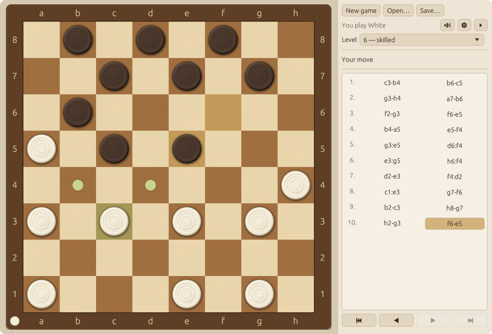
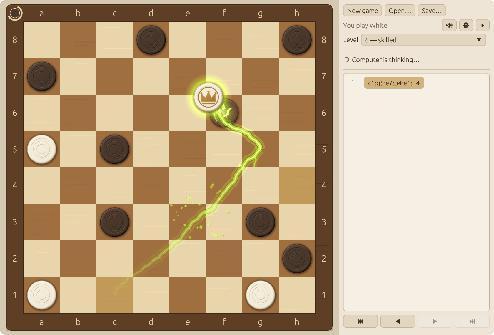
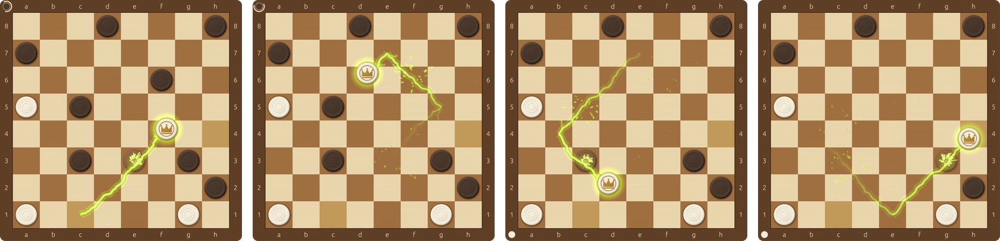
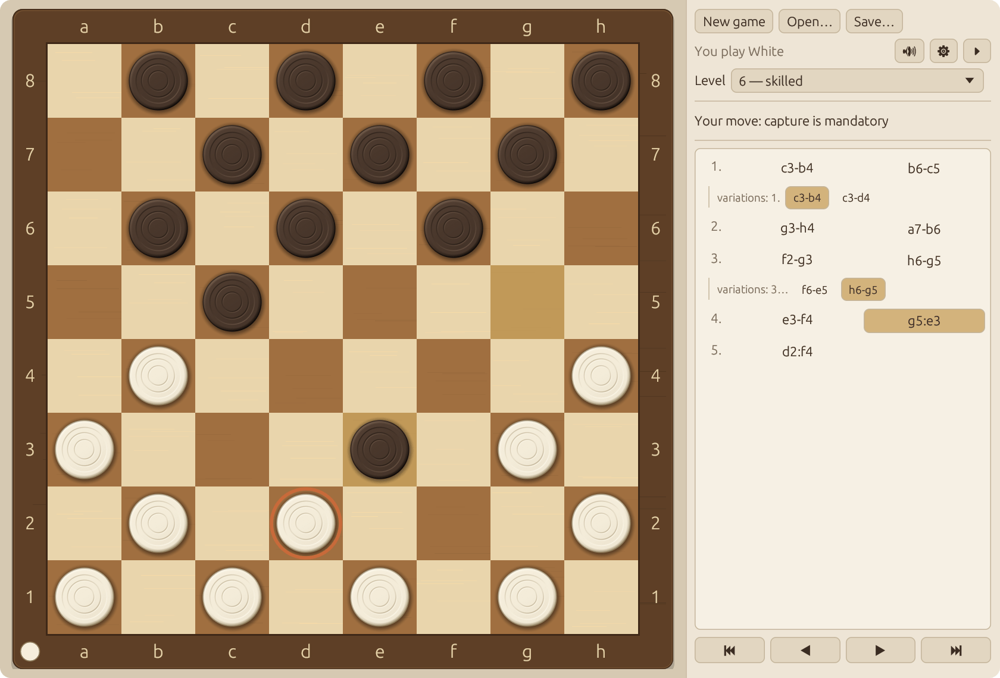
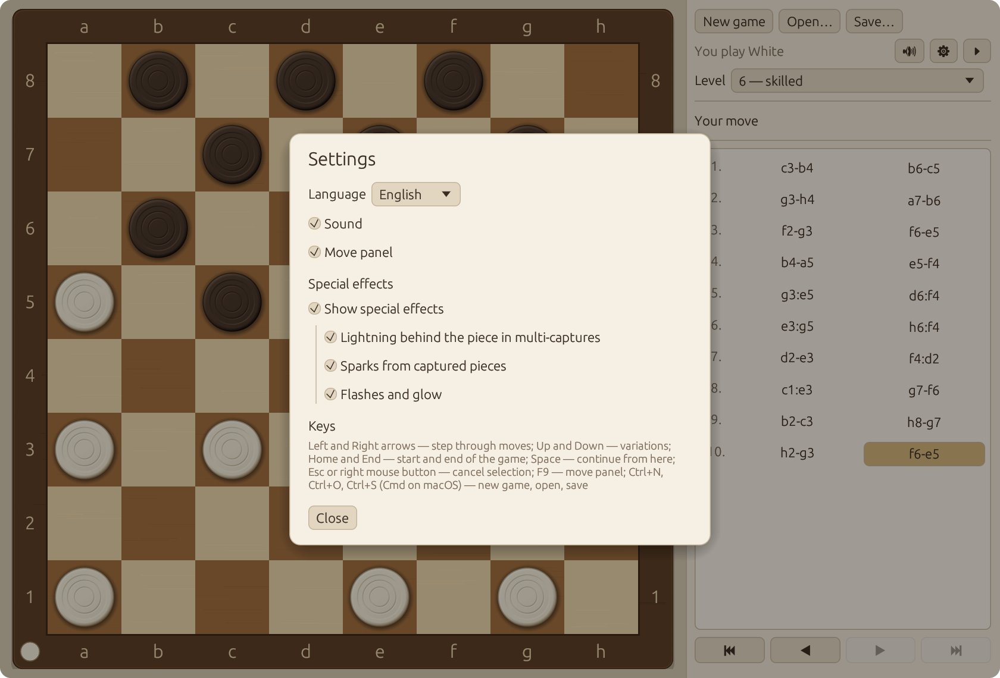
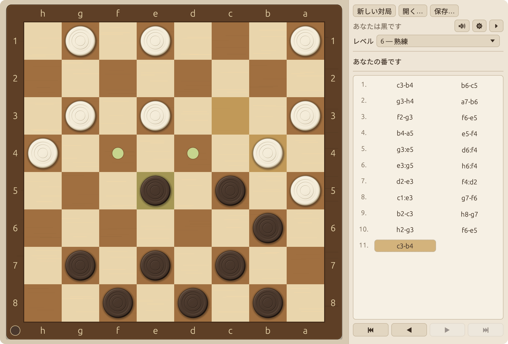
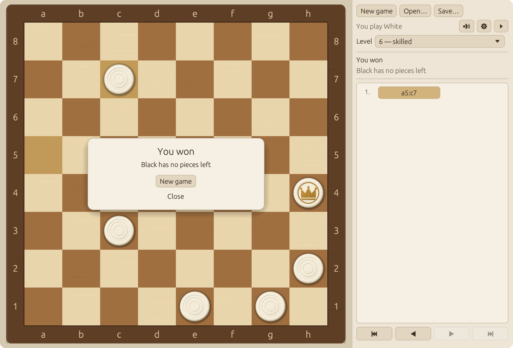

# Russian Draughts

[](https://github.com/zxwild/rucheckers/actions/workflows/ci.yml)

A desktop game of Russian draughts (shashki) against the computer, written in Rust.
It runs on Windows 10 and 11, on macOS and on the mainstream Linux distributions.

*Русская версия этого файла: [README.ru.md](README.ru.md).*



- The official rules of Russian draughts, including the Turkish strike and all five
  conditions of an automatic draw.
- Ten levels of computer strength; on the tenth it thinks up to 4.5 s per move.
- The history of a game is a tree of variations; games are saved and loaded in the PDN
  format (GameType 25).
- The interface is available in twelve languages and switches without a restart.
- One self-contained executable. Images and sounds are made by the program; its only
  resource files are three small font subsets for Chinese, Japanese and Korean.

## Screenshots

A capture of several pieces comes with an electric discharge. Here a king takes five
pieces in one move, `c1:g5:e7:b4:e1:h4`: the lightning trails the flying piece along its
route, and every captured piece bursts into sparks the moment the king passes over it.



The same move from its first jump to the last one:



<table>
  <tr>
    <td width="50%" valign="top">
      
      <p><b>Analysis.</b> A game is kept as a tree. Side lines are listed next to the
      move they replace, and stepping into one shows its position on the board.</p>
    </td>
    <td width="50%" valign="top">
      
      <p><b>Settings.</b> The language, the sound, the move panel and every special
      effect are switched here; the choice is remembered between runs.</p>
    </td>
  </tr>
  <tr>
    <td width="50%" valign="top">
      
      <p><b>Twelve languages.</b> The Japanese interface, and a game with the black
      pieces: the board is turned towards the player.</p>
    </td>
    <td width="50%" valign="top">
      
      <p><b>The end of a game.</b> The result comes with its reason; for a draw the
      rule that ended the game is named.</p>
    </td>
  </tr>
</table>

## Supported systems

| System | Versions | How it is checked |
| --- | --- | --- |
| Windows | 10 and 11, x64 and ARM64 | CI builds the program and runs all tests on Windows (x64 and ARM64), and starts the program on Windows x64 |
| macOS | Apple Silicon and Intel | CI builds the program and runs all tests on both |
| Linux | Ubuntu 22.04, 24.04 and 26.04; Debian 12 and 13; Fedora; Arch Linux; openSUSE Tumbleweed | CI builds the program inside each distribution from the packages listed below, runs all tests and starts the program on a virtual display |

Distributions based on these — Linux Mint, Pop!_OS, Manjaro, EndeavourOS and others —
use the commands of their base. They are not checked separately.

What CI cannot check is covered by the [manual checklist](#manual-checklist): the look of
the window on a real screen, the sound, the system dialogs.

## Building and running

A stable Rust toolchain, version 1.85 or newer, is required. The build needs no other
tools than the ones named for each system.

### Windows 10 and 11

Install Rust with `rustup-init.exe` from <https://rustup.rs>. If the Microsoft C++ build
tools are not on the machine yet, the installer offers to install them; accept, because
the linker and the resource compiler come from there. Then, in a new terminal:

```powershell
cargo build --release
```

```powershell
.\target\release\rucheckers.exe
```

The result is a single file that needs no installation: no DLLs to carry along and no
Visual C++ Redistributable. It carries its own icon and opens no console window. Copy
`rucheckers.exe` wherever it is convenient.

- The program draws with OpenGL 2.0 or newer, which every current graphics driver
  provides. A system without one (some virtual machines and remote sessions) gets a
  message instead of a window.
- The executable is not signed. If it is downloaded from the internet rather than built
  on the machine, SmartScreen asks for a confirmation at the first start.
- The GNU toolchain (`x86_64-pc-windows-gnu`) builds the program as well. Without
  `windres` from MinGW-w64 the build prints a warning and the file has no icon in
  Explorer; the window still has one.

### macOS

```bash
xcode-select --install
```

```bash
curl --proto '=https' --tlsv1.2 -sSf https://sh.rustup.rs | sh
```

```bash
cargo build --release
```

```bash
./target/release/rucheckers
```

The Command Line Tools provide the linker and `libclang`, which the sound library needs
while building (its bindings to CoreAudio are generated at build time).

### Linux

Install the build packages of your distribution:

| Distribution | Command |
| --- | --- |
| Ubuntu 26.04, Debian 13 | `sudo apt install cargo build-essential pkg-config libasound2-dev` |
| Ubuntu 22.04 and 24.04, Debian 12, Linux Mint | `sudo apt install curl build-essential pkg-config libasound2-dev` |
| Fedora | `sudo dnf install cargo gcc pkgconf-pkg-config alsa-lib-devel` |
| Arch Linux, Manjaro | `sudo pacman -S --needed rust gcc pkgconf alsa-lib` |
| openSUSE Tumbleweed | `sudo zypper install cargo gcc pkgconf-pkg-config alsa-devel` |

The distributions of the second row package a Rust older than 1.85, so there the
compiler comes from rustup:

```bash
curl --proto '=https' --tlsv1.2 -sSf https://sh.rustup.rs | sh
```

Then, on every distribution:

```bash
cargo build --release
```

```bash
./target/release/rucheckers
```

The program works under Wayland and under X11 and chooses between them by itself. To
run, it needs only libraries that every desktop installation already has: the Wayland
or X11 client libraries, `libxkbcommon`, Mesa (OpenGL and EGL) and ALSA, which PipeWire
and PulseAudio serve as well. The file dialog is opened through the XDG Desktop Portal
of the desktop; without a portal `zenity` is used.

To add the program to the application menu:

```bash
tools/install-linux.sh
```

The script copies the executable, a desktop entry and the icon into `~/.local`
(`PREFIX=/usr/local` with `sudo` installs for all users, `--uninstall` removes the
files). Under Wayland the desktop entry is also what gives the window its icon in the
dock and in the window switcher.

### Opening a game from the command line

```bash
./target/release/rucheckers game.pdn
```

## Tests

Everything except drawing and sound playback is tested without a window or a sound
device.

```bash
cargo test
```

Long checks (a hundred thousand random games, the ladder of levels, games of the tenth
level, the time limit on all levels and positions) are run separately and take several
minutes:

```bash
cargo test -- --ignored
```

A single group of tests:

```bash
cargo test --test draws
```

| File | What it checks |
| --- | --- |
| `tests/perft.rs` | reference for the move generator: depths 1–9 from the starting position |
| `tests/rules.rs` | every rule of moving and capturing on concrete positions |
| `tests/draws.rs` | every draw condition: the exact move it fires on and the reset of the counters |
| `tests/random_games.rs` | 3000 random games with invariants checked after every move |
| `tests/ai.rs` | legal moves and the time limit on every level, tactics, draws, games between levels |
| `tests/tree_pdn.rs` | the tree of variations, notation, PDN, damaged files |
| `tests/ui_logic.rs` | conversion of mouse coordinates, choosing a move, the game session |

Unit tests are next to the code in `src/`. Among other things they check that every
interface text exists in every language, that templates keep their placeholders, that
the built-in fonts have a glyph for every character of every text, that every
combination of settings survives saving and loading, that the settings file is looked
for in the right place on each system, and that the icon files match the drawing code.

### Continuous integration

`.github/workflows/ci.yml` runs on every push:

- the tests and a release build with the current stable Rust on Linux, Windows (x64 and
  ARM64) and macOS (Apple Silicon and Intel);
- formatting, lints and the tests with Rust 1.85, the oldest supported version, on
  Linux, Windows and macOS;
- on Windows: a check that the release executable depends on system libraries only,
  and a start of the program;
- inside Debian, Ubuntu, Fedora, Arch Linux and openSUSE containers: a build from the
  packages listed above, the tests, and a start of the program on a virtual display
  under X11 and under Wayland.

The machines of CI have no graphics card, so there the program draws with the Mesa
software renderer. A start is a script that can be run by hand. It starts the
program, waits for its window and checks that the board has been drawn:

```bash
tools/smoke-test.sh x11
```

```bash
tools/smoke-test.sh wayland
```

It needs Xvfb and xdotool for X11, Weston for Wayland, and ImageMagick. On Windows
the same check is `tools/smoke-test.ps1`.

### Code quality

```bash
cargo clippy --all-targets
```

The manifest forbids `unsafe` code and enables `clippy::pedantic`; the few exceptions
(numeric casts in geometry, pixel and sound code) are listed in `Cargo.toml` with their
reasons. The command reports no warnings with Rust 1.85, which CI enforces, nor with
Rust 1.100, the current stable release at the time of writing. A newer compiler may add
lints of its own.

## Controls

- A move: click a piece, then a square; or drag the piece.
- A multi-capture can be made one jump at a time (then, with several routes, the player
  chooses the next square) or by pointing at the final square at once (it is marked
  with a ring). Only a square whose capture is determined unambiguously can be pointed
  at directly; if captures with different results lead to one square, the route is
  given jump by jump.
- Right mouse button or `Esc`: clear the selection, cancel an unfinished capture.
- Left and Right arrows: step through the moves; Up and Down: neighbouring variations;
  `Home` and `End`: the start and the end of the game.
- `Space`: "Continue from here" — the computer makes a move from the position shown.
- `F9`: hide or show the move panel.
- `Ctrl+N`, `Ctrl+O`, `Ctrl+S` (`Cmd` on macOS): new game, open, save.

While the history is being browsed the computer does not move. The game resumes with a
move by the human (if it differs from the recorded one, a variation is created) or with
"Continue from here".

### Special effects

A capture of two or more pieces in one move comes with an electric discharge: a
greenish-yellow lightning trails the flying piece along its route and dies out behind
it, and each captured piece flashes and bursts into sparks the moment the capturing
piece flies over it. In the settings, under "Special effects", the effects are switched
off all at once or one by one: lightning, sparks, flashes and glow. With everything off,
a capture of several pieces is shown like an ordinary one: the captured pieces dim and
disappear at the end of the move.

### Languages

The language is chosen in the settings from a list of native names:
Bahasa Indonesia, Deutsch, English, Español, Français, Italiano, Português, Türkçe,
Русский, 简体中文, 日本語, 한국어.

At the first start the language follows the system. On Linux it is named by the locale
variables, read the way gettext reads them: `LC_ALL`, `LC_MESSAGES`, `LANG`, and the
priority list in `LANGUAGE`. On Windows and macOS the same variables win if they are
set; otherwise the language of the user's account is taken. If the system names no
language, Russian is used, and for a language without a translation, English.

Limits of the localization:

- The translations were written together with the program and have not been reviewed by
  native speakers.
- Languages whose scripts need text shaping or right-to-left layout (Arabic, Hindi,
  Bengali, Urdu and others) are not offered: the interface toolkit draws text glyph by
  glyph, left to right, and would show them incorrectly.
- The built-in fonts cover Latin, Cyrillic and exactly the Chinese, Japanese and Korean
  characters of the interface texts. Other characters, for example in the path of a
  file named in an error message, are shown as placeholder boxes.

### Settings

The settings are kept in one file:

| System | File |
| --- | --- |
| Windows | `%APPDATA%\rucheckers\settings.conf` |
| macOS | `~/Library/Application Support/rucheckers/settings.conf` |
| Linux | `~/.config/rucheckers/settings.conf`, or under `$XDG_CONFIG_HOME` if it is set |

The file is plain text of `key=value` lines: `language` (a two-letter code such
as `ru`, `en` or `ja`), `level` (1–10), `color` (`white` or `black`), and the switches
`sound`, `panel`, `effects` (the main switch of the special effects), `effect_lightning`,
`effect_sparks` and `effect_flashes` with the values `on` and `off`. Missing and damaged
lines are replaced with default values.

The file is written after every change — a new game, the level list, any switch in the
settings dialog — so nothing depends on how the program is closed. Writing is atomic
(a temporary file replaces the old one in one step). If the file cannot be written, the
program says so once and goes on working.

## Structure

The library `rucheckers` (`src/lib.rs`) does not depend on a window:

| Module | Purpose |
| --- | --- |
| `board` | squares, pieces, a position (bit masks), FEN |
| `moves` | moves, the move generator, making and taking back a move, perft |
| `rules` | the end of a game, counters and limits of the draws (named constants) |
| `notation` | Russian notation: `c3-d4`, `c3:e5:g7` |
| `tree` | the game tree with variations |
| `pdn` | writing and parsing PDN |
| `ai` | evaluation, search, levels, the background calculation thread |
| `ui::geometry` | placement of the board, mouse coordinates → square |
| `ui::input` | choosing a move with clicks and dragging |
| `ui::anim` | timing of animation frames |
| `ui::fx` | the electric discharge of a multi-capture: lightning behind the piece, flashes, sparks |
| `ui::sprite` | the picture of a piece: computed pixel by pixel with anti-aliasing |
| `ui::icon` | the application icon, drawn with the same code, and its `.ico` and `.png` files |
| `ui::session` | a game against the computer: whose move it is, browsing the history, variations |
| `i18n` | interface texts: one module per language (`src/i18n/*.rs`) and the message templates |
| `settings`, `sound`, `rng` | settings, sound synthesis, the random number generator |

The executable (`src/main.rs`, `src/gui/`) contains only the window, drawing, fonts,
sound playback and system dialogs.

Around the code:

| Path | Purpose |
| --- | --- |
| `build.rs` | puts the icon, the version information and the manifest into the Windows executable |
| `assets/fonts/` | the font subsets for Chinese, Japanese and Korean |
| `assets/icons/` | the icon as `.ico` (Windows) and `.png` (Linux), written by the program |
| `assets/windows/` | the application manifest: Windows 10 and 11, sharp drawing on dense screens |
| `assets/linux/` | the desktop entry with the name of the program in every language |
| `tools/` | installation into the Linux application menu, the smoke tests, the font subsetting script |
| `examples/icons.rs` | writes the icon files |
| `docs/screenshots/` | the pictures of this file |

Dependencies: `eframe` (window and vector drawing), `winit` (the windowing library
`eframe` runs on; listed explicitly so that the window has a title bar under Wayland),
`rodio` (sound output), `rfd` (the system file dialog), `sys-locale` (the language of
the user's account; Windows and macOS only) and, at build time, `winresource` (the
resources of the Windows executable). The versions are pinned in `Cargo.toml` and
`Cargo.lock`.

### Changing the texts

Every language is a file in `src/i18n/` with one `match` over all text keys, so a
missing text does not compile. After changing the Chinese, Japanese or Korean texts,
rebuild the font subsets (the font test fails until they cover the texts):

```bash
tools/subset_cjk_fonts.py /usr/share/fonts/opentype/noto/NotoSansCJK-Regular.ttc
```

The script needs `fonttools` (`pip install fonttools`) and Noto Sans CJK (the package
`fonts-noto-cjk` on Debian). The subsets in `assets/fonts/` are distributed under the
SIL Open Font License 1.1, see `assets/fonts/OFL.txt`.

### Changing the icon

The icon is the white man of the board on a dark square, drawn by `ui::icon`. The
Windows executable and the Linux desktop entry need it as a file, so the files are kept
in `assets/icons/`. After changing the drawing of a piece or of the icon, write them
again (a test fails until they match the drawing code):

```bash
cargo run --example icons
```

## Assumptions

Rules:

1. The "balance of forces" is the number of men and kings of each side. It changes with
   every capture and every promotion; the counters of rules 2, 4 and 5 are then reset.
2. Rule 2 (three or more kings against one): the stronger side has at least three
   kings and may have men as well; the weaker side has a single king. The moves of the
   stronger side are counted; the draw is declared right after its 15th move.
3. Rule 5 (the main road): the count runs while the lone king stands on the main road
   after every move. If it leaves the road, the count stops, and it starts anew when
   the king returns.
4. A move after which the opponent has no moves wins even if the same move exhausts a
   draw limit.
5. If several rules fire at once, the reason is named after the first of them in the
   order 1, 2, 3, 4, 5.
6. A repetition is the same placement and side to move on the branch that leads to the
   current position; neighbouring variations are not counted.

The computer:

7. The limit of the tenth level is 4.5 s of calculation; the margin up to 5 s is left
   for overhead. Levels 1–7 are limited by depth and do not depend on the speed of the
   computer.
8. The weakness of the lower levels is a small depth, a random error in the evaluation,
   "careless" moves that do not check the capture in reply, and now and then a random
   move.
9. A pause of at least 0.6 s is kept before the computer's reply.
10. The search is single-threaded.

Files:

11. From a PDN file with several games the first one is read.
12. A record in which moves continue after the game has ended by the rules of this
    program is rejected with a message.
13. The capture separators `:` and `x` are accepted, and so is a shortened capture if
    it is unambiguous. Numeric square notation is not supported.
14. The date in the PDN header is in universal time.
15. The player's colour is restored from the tags `WhiteType` and `BlackType`; the
    level does not change on loading.

Interface:

16. The default language follows the system; Russian is used when the system names no
    language, English for a language without a translation.
17. A loaded game opens at the last move of the main line, in browsing mode.

## Manual checklist

The tests do not cover what is seen and heard. Before a release it is worth going
through this list on every system.

Appearance

- [ ] The board is in warm wood tones, with a frame carrying the letters `a–h` and the
      digits `1–8` on all sides.
- [ ] The square `a1` is dark, at the bottom left when playing White.
- [ ] A piece is an even circle in the centre of its cell, with smooth edges.
- [ ] A king differs from a man at a glance (a crown and a golden ring).
- [ ] Text in the panel, the dialogs and the window title is shown without placeholder
      boxes in every language, Chinese, Japanese and Korean included.
- [ ] Highlights: the selected piece, reachable squares, pieces that must capture, the
      last move.

Scaling

- [ ] The window resizes freely; the board stays square and centred.
- [ ] Cell borders and pieces are sharp at any window size.
- [ ] On a high-density screen (Retina; 150–200 % scale on Linux) the picture is crisp.
- [ ] With the panel hidden (`F9`) the board takes the whole window.

Play

- [ ] The player's colour is at the bottom; when playing Black the board is turned and
      the computer moves first.
- [ ] Moves by clicks and by dragging; a piece dropped elsewhere returns to its place.
- [ ] A multi-capture goes step by step or with one click on the final square (marked
      with a ring); captured pieces dim and disappear at the end of the move.
- [ ] While the computer is thinking the interface responds and the indicator is
      visible (in the panel and in the corner of the board frame).
- [ ] A new game and a step through the history can be started without waiting for the
      computer's reply.
- [ ] At the end of a game the result and the reason are shown; for a draw the rule is
      named.

Animation and sound

- [ ] Moves and captures travel smoothly, without jerks.
- [ ] When two or more pieces are captured, a greenish-yellow lightning trails the
      flying piece along its route (together with the movement, not after it); captured
      pieces burst into sparks as the capturing piece flies over them; the game does
      not slow down.
- [ ] In the settings, under "Special effects", the main switch removes all effects and
      the separate boxes remove the lightning, the sparks, and the flashes and glow one
      by one.
- [ ] The sounds of a move, a capture, a discharge, a promotion and the end of a game
      are distinct and not harsh.
- [ ] The sound button switches the sound off and on; the program works without a sound
      device.

Files and settings

- [ ] "Save…" and "Open…" bring up the system dialog; the `.pdn` extension is added
      automatically.
- [ ] A saved game with variations opens without losses.
- [ ] A foreign or damaged file gives a clear message, and the game does not change.
- [ ] The language, level, colour, sound, panel visibility and the choice of special
      effects are restored after a restart.
- [ ] The language list shows all twelve languages; choosing one changes every text at
      once, including the window title.
- [ ] At the very first start the interface is in the language of the system.

Windows

- [ ] `rucheckers.exe` has the icon of the program in Explorer and on the taskbar; no
      console window opens next to the game.
- [ ] The file runs after being copied to another folder or another computer, without
      installing anything.
- [ ] With the display scale at 150 % or 200 % the picture is sharp, also after the
      window is moved to a monitor of another scale.

Linux

- [ ] The program starts in a Wayland session and in an X11 session; under GNOME on
      Wayland the window has a title bar.
- [ ] After `tools/install-linux.sh` the program is in the application menu under its
      name in the language of the desktop, and its window has the icon in the dock.
