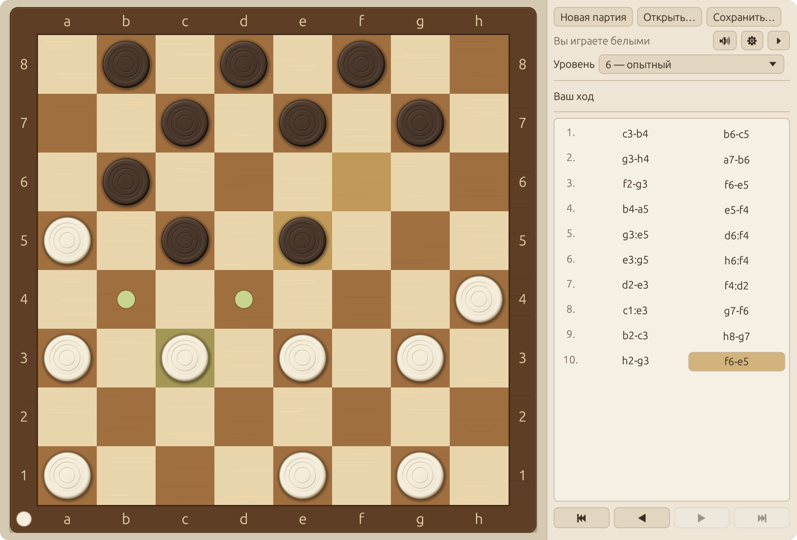
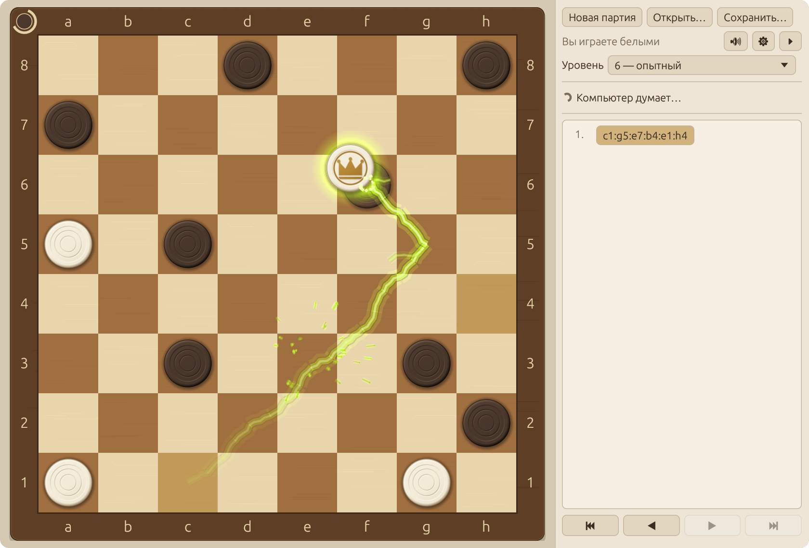
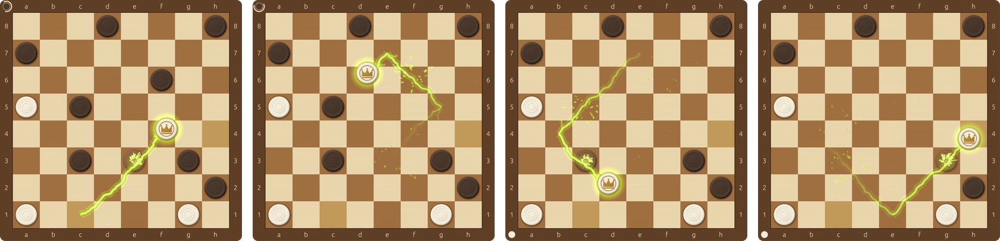
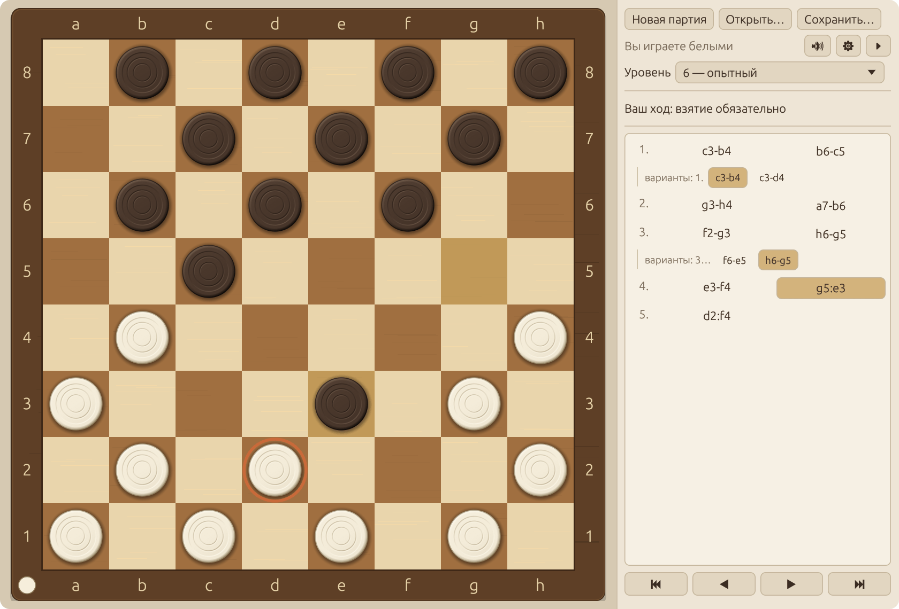
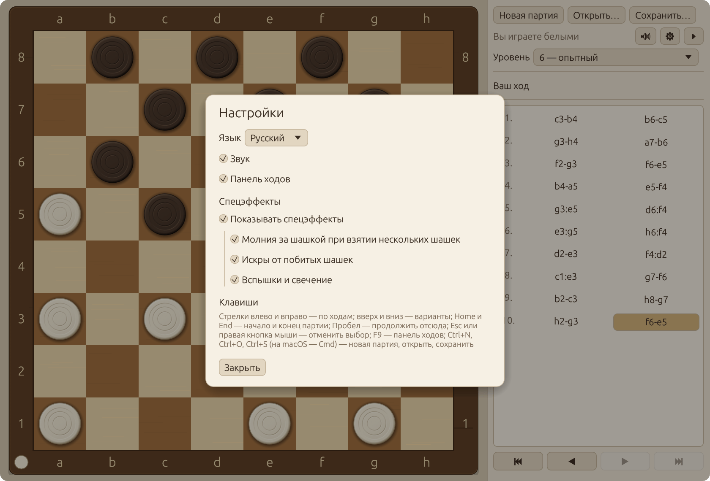
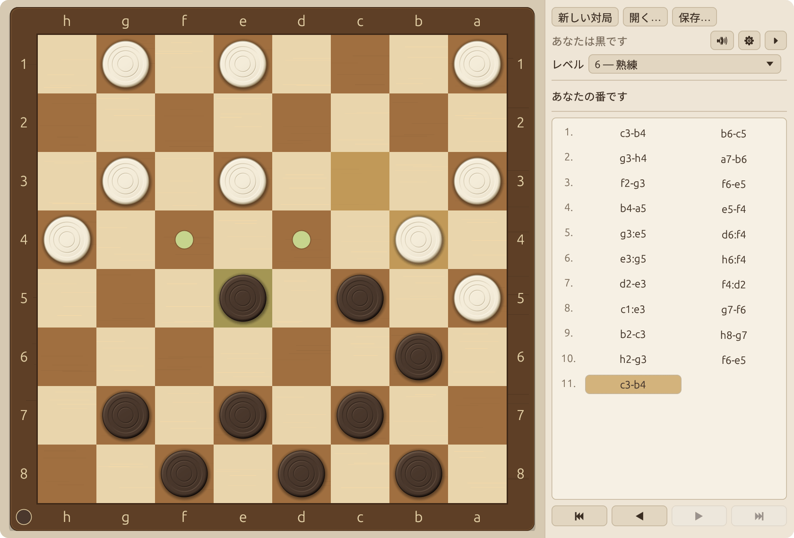
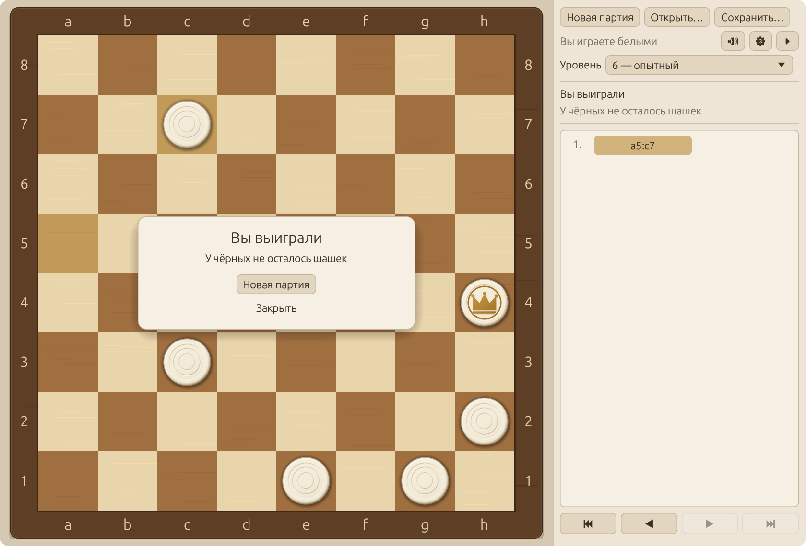

# Русские шашки

[](https://github.com/zxwild/rucheckers/actions/workflows/ci.yml)

Настольная игра в русские шашки против компьютера, написанная на Rust. Работает
в Windows 10 и 11, в macOS и в распространённых дистрибутивах Linux.

*Основная версия этого файла — английская: [README.md](README.md).*



- Официальные правила русских шашек, включая турецкий удар и все пять условий
  автоматической ничьей.
- Десять уровней силы компьютера; на десятом он думает до 4,5 с на ход.
- История партии — дерево вариантов; сохранение и загрузка в формате PDN (GameType 25).
- Интерфейс на двенадцати языках, язык переключается без перезапуска.
- Один самодостаточный исполняемый файл. Изображения и звуки создаёт сама программа;
  единственные файлы ресурсов — три небольших набора глифов для китайского, японского
  и корейского языков.

## Снимки экрана

Взятие нескольких шашек сопровождается электрическим разрядом. Здесь дамка берёт пять
шашек за один ход, `c1:g5:e7:b4:e1:h4`: молния тянется за летящей шашкой по её маршруту,
а каждая взятая шашка рассыпается искрами в тот момент, когда дамка проходит над ней.



Тот же ход от первого прыжка до последнего:



<table>
  <tr>
    <td width="50%" valign="top">
      
      <p><b>Разбор партии.</b> Партия хранится как дерево. Боковые варианты перечислены
      рядом с ходом, который они заменяют; при переходе в вариант его позиция
      показывается на доске.</p>
    </td>
    <td width="50%" valign="top">
      
      <p><b>Настройки.</b> Здесь переключаются язык, звук, панель ходов и каждый
      спецэффект; выбор запоминается между запусками.</p>
    </td>
  </tr>
  <tr>
    <td width="50%" valign="top">
      
      <p><b>Двенадцать языков.</b> Японский интерфейс и партия чёрными: доска
      развёрнута к игроку.</p>
    </td>
    <td width="50%" valign="top">
      
      <p><b>Конец партии.</b> Результат сообщается вместе с причиной; при ничьей
      называется правило, по которому партия закончилась.</p>
    </td>
  </tr>
</table>

## Поддерживаемые системы

| Система | Версии | Как проверяется |
| --- | --- | --- |
| Windows | 10 и 11, x64 и ARM64 | CI собирает программу и выполняет все тесты в Windows (x64 и ARM64) |
| macOS | Apple Silicon и Intel | CI собирает программу и выполняет все тесты на обеих архитектурах |
| Linux | Ubuntu 22.04, 24.04 и 26.04; Debian 12 и 13; Fedora; Arch Linux; openSUSE Tumbleweed | CI собирает программу внутри каждого дистрибутива из пакетов, перечисленных ниже, выполняет все тесты и запускает программу на виртуальном экране |

Дистрибутивы, основанные на перечисленных, — Linux Mint, Pop!_OS, Manjaro, EndeavourOS
и другие — используют команды своей основы. Отдельно они не проверяются.

То, что CI проверить не может, вынесено в список [ручной проверки](#ручная-проверка):
вид окна на настоящем экране, звук, системные диалоги.

## Сборка и запуск

Нужен стабильный Rust версии 1.85 или новее. Кроме названного для каждой системы,
сборке ничего не требуется.

### Windows 10 и 11

Установите Rust программой `rustup-init.exe` с <https://rustup.rs>. Если средств сборки
Microsoft C++ на компьютере ещё нет, установщик предложит поставить их; согласитесь:
оттуда берутся компоновщик и компилятор ресурсов. Затем в новом окне терминала:

```powershell
cargo build --release
```

```powershell
.\target\release\rucheckers.exe
```

Получается один файл, не требующий установки: с ним не нужно носить DLL и не нужен
пакет Visual C++ Redistributable. У файла есть собственный значок, а окно консоли
при запуске не открывается. `rucheckers.exe` можно скопировать в любое удобное место.

- Программа рисует через OpenGL 2.0 или новее; его даёт любой современный драйвер
  видеокарты. Там, где такого драйвера нет (некоторые виртуальные машины и удалённые
  сеансы), вместо окна появится сообщение.
- Исполняемый файл не подписан. Если он не собран на этом компьютере, а скачан
  из интернета, SmartScreen при первом запуске попросит подтверждение.
- Программа собирается и тулчейном GNU (`x86_64-pc-windows-gnu`). Без `windres`
  из MinGW-w64 сборка выдаёт предупреждение, и у файла в Проводнике нет значка;
  у окна он есть в любом случае.

### macOS

```bash
xcode-select --install
```

```bash
curl --proto '=https' --tlsv1.2 -sSf https://sh.rustup.rs | sh
```

```bash
cargo build --release
```

```bash
./target/release/rucheckers
```

Command Line Tools дают компоновщик и `libclang`, который нужен звуковой библиотеке
при сборке (привязки к CoreAudio генерируются во время сборки).

### Linux

Установите пакеты для сборки в своём дистрибутиве:

| Дистрибутив | Команда |
| --- | --- |
| Ubuntu 26.04, Debian 13 | `sudo apt install cargo build-essential pkg-config libasound2-dev` |
| Ubuntu 22.04 и 24.04, Debian 12, Linux Mint | `sudo apt install curl build-essential pkg-config libasound2-dev` |
| Fedora | `sudo dnf install cargo gcc pkgconf-pkg-config alsa-lib-devel` |
| Arch Linux, Manjaro | `sudo pacman -S --needed rust gcc pkgconf alsa-lib` |
| openSUSE Tumbleweed | `sudo zypper install cargo gcc pkgconf-pkg-config alsa-devel` |

В дистрибутивах из второй строки Rust в пакетах старше 1.85, поэтому компилятор
там ставится через rustup:

```bash
curl --proto '=https' --tlsv1.2 -sSf https://sh.rustup.rs | sh
```

Дальше в любом дистрибутиве:

```bash
cargo build --release
```

```bash
./target/release/rucheckers
```

Программа работает и под Wayland, и под X11 и сама выбирает между ними. Для запуска
ей нужны только библиотеки, которые есть в любой настольной установке: клиентские
библиотеки Wayland или X11, `libxkbcommon`, Mesa (OpenGL и EGL) и ALSA, которую
обслуживают также PipeWire и PulseAudio. Диалог выбора файла открывается через
XDG Desktop Portal рабочего стола; без портала используется `zenity`.

Чтобы добавить программу в меню приложений:

```bash
tools/install-linux.sh
```

Скрипт копирует исполняемый файл, ярлык и значок в `~/.local` (`PREFIX=/usr/local`
вместе с `sudo` ставит программу для всех пользователей, `--uninstall` удаляет файлы).
Под Wayland именно ярлык даёт окну значок в панели и в переключателе окон.

### Открытие партии из командной строки

```bash
./target/release/rucheckers game.pdn
```

## Тесты

Всё, кроме отрисовки и воспроизведения звука, проверяется без окна и звукового
устройства.

```bash
cargo test
```

Долгие проверки (сто тысяч случайных партий, лестница уровней, партии десятого уровня,
лимит времени на всех уровнях и позициях) запускаются отдельно и занимают
несколько минут:

```bash
cargo test -- --ignored
```

Отдельная группа тестов:

```bash
cargo test --test draws
```

| Файл | Что проверяет |
| --- | --- |
| `tests/perft.rs` | эталон генератора ходов: глубины 1–9 из начальной позиции |
| `tests/rules.rs` | каждое правило хода и взятия на конкретных позициях |
| `tests/draws.rs` | каждое условие ничьей: точный ход срабатывания и сброс счётчиков |
| `tests/random_games.rs` | 3000 случайных партий с проверкой инвариантов после каждого хода |
| `tests/ai.rs` | допустимость ходов и лимит времени на каждом уровне, тактика, ничьи, партии уровней между собой |
| `tests/tree_pdn.rs` | дерево вариантов, нотация, PDN, повреждённые файлы |
| `tests/ui_logic.rs` | пересчёт координат мыши, выбор хода, игровая сессия |

Модульные тесты лежат рядом с кодом в `src/`. Среди прочего они проверяют, что каждый
текст интерфейса есть на каждом языке, что шаблоны сообщений сохраняют свои подстановки,
что во встроенных шрифтах есть глиф для каждого символа каждого текста, что любое
сочетание настроек переживает сохранение и загрузку, что файл настроек ищется в нужном
месте в каждой системе и что файлы значка соответствуют коду, который его рисует.

### Непрерывная интеграция

`.github/workflows/ci.yml` выполняется при каждой отправке изменений:

- тесты и выпускная сборка текущим стабильным Rust в Linux, Windows (x64 и ARM64)
  и macOS (Apple Silicon и Intel);
- форматирование, замечания clippy и тесты на Rust 1.85, самой старой поддерживаемой
  версии, — в Linux, Windows и macOS;
- в контейнерах Debian, Ubuntu, Fedora, Arch Linux и openSUSE: сборка из пакетов,
  перечисленных выше, тесты и запуск программы на виртуальном экране под X11
  и под Wayland.

Последний шаг — скрипт, который можно выполнить и вручную. Он запускает программу,
дожидается её окна и проверяет, что доска нарисована:

```bash
tools/smoke-test.sh x11
```

```bash
tools/smoke-test.sh wayland
```

Ему нужны Xvfb и xdotool для X11, Weston для Wayland и ImageMagick.

### Качество кода

```bash
cargo clippy --all-targets
```

В манифесте запрещён `unsafe`-код и включён набор `clippy::pedantic`; немногие исключения
(числовые преобразования в геометрии, расчёте пикселей и звука) перечислены в `Cargo.toml`
с обоснованием. Команда не выдаёт предупреждений на Rust 1.85 (за этим следит CI)
и на Rust 1.100 — текущем стабильном выпуске на момент написания. Более новый компилятор
может добавить собственные замечания. Комментарии и сообщения в коде написаны
на английском языке.

## Управление

- Ход: щелчок по шашке, затем по полю, либо перетаскивание.
- Серийное взятие можно выполнять по одному прыжку — тогда при нескольких маршрутах
  следующее поле выбирает игрок — или сразу указать конечное поле (оно отмечено
  кольцом). Сразу указать можно только поле, взятие на которое определено однозначно;
  если на одно поле ведут взятия с разным результатом, маршрут уточняется прыжками.
- Правая кнопка мыши или `Esc` — снять выбор, отменить незаконченное взятие.
- Стрелки влево и вправо — по ходам; вверх и вниз — соседние варианты;
  `Home` и `End` — начало и конец партии.
- `Пробел` — «Продолжить отсюда»: компьютер делает ход из показанной позиции.
- `F9` — скрыть или показать панель ходов.
- `Ctrl+N`, `Ctrl+O`, `Ctrl+S` (на macOS — `Cmd`) — новая партия, открыть, сохранить.

Во время просмотра истории компьютер не ходит. Игра возобновляется ходом человека
(если ход отличается от записанного, создаётся вариант) или командой «Продолжить отсюда».

### Спецэффекты

Взятие двух и более шашек за ход сопровождается электрическим разрядом: за летящей
шашкой по её пути тянется зеленовато-жёлтая молния и гаснет позади, а побитая шашка
вспыхивает и рассыпается искрами в тот момент, когда над ней пролетает бьющая.
В окне настроек, в разделе «Спецэффекты», эффекты отключаются все сразу или по
отдельности: молния, искры, вспышки и свечение. Если всё выключено, взятие нескольких
шашек показывается как обычное: побитые шашки бледнеют и исчезают в конце хода.

### Языки

Язык выбирается в настройках из списка, где каждый язык назван на нём самом:
Bahasa Indonesia, Deutsch, English, Español, Français, Italiano, Português, Türkçe,
Русский, 简体中文, 日本語, 한국어.

При первом запуске язык берётся у системы. В Linux его называют переменные локали,
которые читаются так же, как их читает gettext: `LC_ALL`, `LC_MESSAGES`, `LANG`
и список предпочтений `LANGUAGE`. В Windows и macOS те же переменные имеют приоритет,
если заданы; иначе берётся язык учётной записи пользователя. Если система языка
не называет, выбирается русский, а для языка, перевода на который нет, — английский.

Ограничения локализации:

- Переводы написаны вместе с программой и не вычитаны носителями языков.
- Языки, письменность которых требует сборки текста из связанных форм или письма справа
  налево (арабский, хинди, бенгальский, урду и другие), не предлагаются: библиотека
  интерфейса выводит текст по одному глифу слева направо и показала бы их неправильно.
- Встроенные шрифты содержат латиницу, кириллицу и ровно те китайские, японские и
  корейские знаки, которые есть в текстах интерфейса. Другие знаки — например, в пути
  к файлу, названному в сообщении об ошибке, — показываются пустыми прямоугольниками.

### Настройки

Настройки хранятся в одном файле:

| Система | Файл |
| --- | --- |
| Windows | `%APPDATA%\rucheckers\settings.conf` |
| macOS | `~/Library/Application Support/rucheckers/settings.conf` |
| Linux | `~/.config/rucheckers/settings.conf` либо каталог из `$XDG_CONFIG_HOME`, если он задан |

Это текстовый файл из строк `ключ=значение`: `language` (двухбуквенный код, например `ru`,
`en` или `ja`), `level` (1–10), `color` (`white` или `black`) и переключатели `sound`,
`panel`, `effects` (общий выключатель спецэффектов), `effect_lightning`, `effect_sparks`,
`effect_flashes` со значениями `on` и `off`. Отсутствующие и испорченные строки
заменяются значениями по умолчанию.

Файл записывается после каждого изменения — новой партии, выбора уровня в списке, любого
флажка в окне настроек, — поэтому ничего не зависит от того, как закрыта программа.
Запись атомарна (временный файл заменяет прежний за один шаг). Если записать файл
не удалось, программа один раз сообщает об этом и продолжает работать.

## Устройство

Библиотека `rucheckers` (`src/lib.rs`) не зависит от окна:

| Модуль | Назначение |
| --- | --- |
| `board` | поля, фигуры, позиция (битовые маски), FEN |
| `moves` | ходы, генератор ходов, выполнение и отмена хода, perft |
| `rules` | окончание партии, счётчики и лимиты ничьих (именованные константы) |
| `notation` | русская нотация: `c3-d4`, `c3:e5:g7` |
| `tree` | дерево партии с вариантами |
| `pdn` | запись и разбор PDN |
| `ai` | оценка, поиск, уровни, фоновый поток расчёта |
| `ui::geometry` | размещение доски, координаты мыши → поле |
| `ui::input` | выбор хода щелчками и перетаскиванием |
| `ui::anim` | расчёт кадров анимации |
| `ui::fx` | электрический разряд при взятии нескольких шашек: молния за шашкой, вспышки, искры |
| `ui::sprite` | изображение шашки: попиксельный расчёт со сглаживанием |
| `ui::icon` | значок приложения, нарисованный тем же кодом, и его файлы `.ico` и `.png` |
| `ui::session` | партия с компьютером: очередь хода, просмотр истории, варианты |
| `i18n` | тексты интерфейса: по модулю на язык (`src/i18n/*.rs`) и шаблоны сообщений |
| `settings`, `sound`, `rng` | настройки, синтез звуков, генератор случайных чисел |

Исполняемый файл (`src/main.rs`, `src/gui/`) содержит только окно, отрисовку, шрифты,
воспроизведение звука и системные диалоги.

Вокруг кода:

| Путь | Назначение |
| --- | --- |
| `build.rs` | помещает значок, сведения о версии и манифест в исполняемый файл для Windows |
| `assets/fonts/` | наборы глифов для китайского, японского и корейского языков |
| `assets/icons/` | значок в виде `.ico` (Windows) и `.png` (Linux), записанный программой |
| `assets/windows/` | манифест приложения: Windows 10 и 11, чёткая картинка на плотных экранах |
| `assets/linux/` | ярлык с названием программы на каждом языке |
| `tools/` | установка в меню приложений Linux, тест запуска, скрипт для наборов глифов |
| `examples/icons.rs` | записывает файлы значка |
| `docs/screenshots/` | иллюстрации этого файла |

Зависимости: `eframe` (окно и векторная отрисовка), `winit` (оконная библиотека, на которой
работает `eframe`; указана явно, чтобы под Wayland у окна был заголовок), `rodio` (вывод
звука), `rfd` (системный диалог выбора файла), `sys-locale` (язык учётной записи
пользователя; только Windows и macOS) и, на этапе сборки, `winresource` (ресурсы
исполняемого файла для Windows). Версии зафиксированы в `Cargo.toml` и `Cargo.lock`.

### Изменение текстов

Каждый язык — файл в `src/i18n/` с одним выражением `match` по всем ключам текстов,
поэтому пропущенный текст не даёт программе собраться. После изменения китайских,
японских или корейских текстов нужно пересобрать наборы глифов (до этого тест шрифтов
не проходит):

```bash
tools/subset_cjk_fonts.py /usr/share/fonts/opentype/noto/NotoSansCJK-Regular.ttc
```

Скрипту нужны `fonttools` (`pip install fonttools`) и шрифт Noto Sans CJK (в Debian —
пакет `fonts-noto-cjk`). Наборы в `assets/fonts/` распространяются по лицензии
SIL Open Font License 1.1, см. `assets/fonts/OFL.txt`.

### Изменение значка

Значок — белая шашка с доски на тёмном поле; его рисует `ui::icon`. Исполняемому файлу
для Windows и ярлыку в Linux значок нужен в виде файла, поэтому файлы лежат
в `assets/icons/`. После изменения рисунка шашки или значка их нужно записать заново
(до этого тест не проходит):

```bash
cargo run --example icons
```

## Принятые допущения

Правила:

1. «Соотношение сил» — число простых и дамок каждой стороны. Оно меняется при любом
   взятии и любом превращении; счётчики правил 2, 4 и 5 при этом обнуляются.
2. Правило 2 (три и более дамки против одной): у сильнейшей стороны не менее трёх
   дамок, простые у неё допускаются; у слабейшей — единственная дамка.
   Считаются ходы сильнейшей стороны; ничья фиксируется сразу после её 15-го хода.
3. Правило 5 (большая дорога): отсчёт идёт, пока одинокая дамка стоит на большой дороге
   после каждого хода. Если она дорогу покинула, отсчёт прерывается, а при возвращении
   начинается заново.
4. Ход, после которого у соперника нет ходов, выигрывает, даже если этим же ходом
   исчерпан лимит ничьей.
5. При одновременном срабатывании нескольких правил причина называется по первому
   из них в порядке 1, 2, 3, 4, 5.
6. Повторением считается совпадение расстановки и очереди хода на ветке, ведущей
   к текущей позиции; соседние варианты не учитываются.

Компьютер:

7. Лимит десятого уровня — 4,5 с на расчёт; запас до 5 с оставлен на накладные расходы.
   Уровни 1–7 ограничены глубиной и от скорости компьютера не зависят.
8. Слабость младших уровней — это малая глубина, случайная погрешность оценки,
   «невнимательные» ходы без проверки ответного взятия и изредка случайный ход.
9. Перед ответом компьютера выдерживается пауза не менее 0,6 с.
10. Поиск однопоточный.

Файлы:

11. Из файла PDN с несколькими партиями читается первая.
12. Запись партии, в которой ходы продолжаются после окончания по правилам этой
    программы, отклоняется с сообщением.
13. Принимаются разделители взятия `:` и `x`, а также сокращённая запись взятия,
    если она однозначна. Числовая нотация полей не поддерживается.
14. Дата в заголовке PDN — по всемирному времени.
15. Цвет игрока восстанавливается из тегов `WhiteType` и `BlackType`; уровень
    при загрузке не меняется.

Интерфейс:

16. Язык по умолчанию берётся у системы; если она языка не называет, выбирается
    русский, для языка без перевода — английский.
17. Загруженная партия открывается на последнем ходе основной линии в режиме просмотра.

## Ручная проверка

Тесты не покрывают то, что видно и слышно. Перед выпуском стоит пройти этот список
в каждой системе.

Внешний вид

- [ ] Доска в тёплых древесных тонах, рамка с буквами `a–h` и цифрами `1–8` со всех сторон.
- [ ] Поле `a1` тёмное, слева внизу при игре белыми.
- [ ] Шашка — ровный круг по центру клетки, края гладкие, без «лесенок».
- [ ] Дамка отличается от простой с первого взгляда (корона и золотистое кольцо).
- [ ] Текст в панели, диалогах и заголовке окна отображается без «квадратиков» на
      каждом языке, включая китайский, японский и корейский.
- [ ] Подсветка: выбранная шашка, доступные поля, шашки, обязанные бить, последний ход.

Масштабирование

- [ ] Окно свободно растягивается; доска остаётся квадратной и отцентрованной.
- [ ] Линии клеток и шашки резкие при любом размере окна.
- [ ] На экране высокой плотности (Retina; масштаб 150–200 % в Linux) изображение чёткое.
- [ ] При скрытой панели (`F9`) доска занимает всё окно.

Игра

- [ ] Цвет игрока внизу; при игре чёрными доска перевёрнута, первым ходит компьютер.
- [ ] Ход щелчками и перетаскиванием; брошенная мимо шашка возвращается на место.
- [ ] Серийное взятие идёт по шагам или одним щелчком по конечному полю (отмечено
      кольцом); побитые шашки бледнеют и исчезают в конце хода.
- [ ] Пока компьютер думает, интерфейс отзывается, а индикатор виден
      (в панели и в углу рамки доски).
- [ ] Новую партию и переход по истории можно начать, не дожидаясь ответа компьютера.
- [ ] В конце партии показаны результат и причина; для ничьей названо правило.

Анимация и звук

- [ ] Ходы и взятия движутся плавно, без рывков.
- [ ] При взятии двух и более шашек за летящей шашкой по её пути тянется
      зеленовато-жёлтая молния (одновременно с движением, а не после него); побитые
      шашки рассыпаются искрами, когда над ними пролетает бьющая; игра не тормозит.
- [ ] В настройках, в разделе «Спецэффекты», общий выключатель убирает все эффекты,
      а отдельные флажки — молнию, искры, вспышки и свечение по одному.
- [ ] Звуки хода, взятия, разряда, превращения и конца партии различимы и не режут слух.
- [ ] Кнопка звука отключает и включает звук; без звукового устройства программа работает.

Файлы и настройки

- [ ] «Сохранить…» и «Открыть…» вызывают системный диалог; расширение `.pdn`
      добавляется само.
- [ ] Сохранённая партия с вариантами открывается без потерь.
- [ ] Посторонний или повреждённый файл даёт понятное сообщение, партия не меняется.
- [ ] Язык, уровень, цвет, звук, видимость панели и выбор спецэффектов сохраняются
      после перезапуска.
- [ ] В списке языков видны все двенадцать; выбор языка сразу меняет все тексты,
      включая заголовок окна.
- [ ] При самом первом запуске интерфейс открывается на языке системы.

Windows

- [ ] У `rucheckers.exe` в Проводнике и на панели задач значок программы; окно консоли
      рядом с игрой не открывается.
- [ ] Файл запускается после копирования в другую папку или на другой компьютер,
      ничего устанавливать не нужно.
- [ ] При масштабе экрана 150 % и 200 % картинка чёткая, в том числе после переноса
      окна на монитор с другим масштабом.

Linux

- [ ] Программа запускается в сеансе Wayland и в сеансе X11; в GNOME под Wayland
      у окна есть заголовок.
- [ ] После `tools/install-linux.sh` программа есть в меню приложений под названием
      на языке рабочего стола, а у её окна есть значок в панели.
