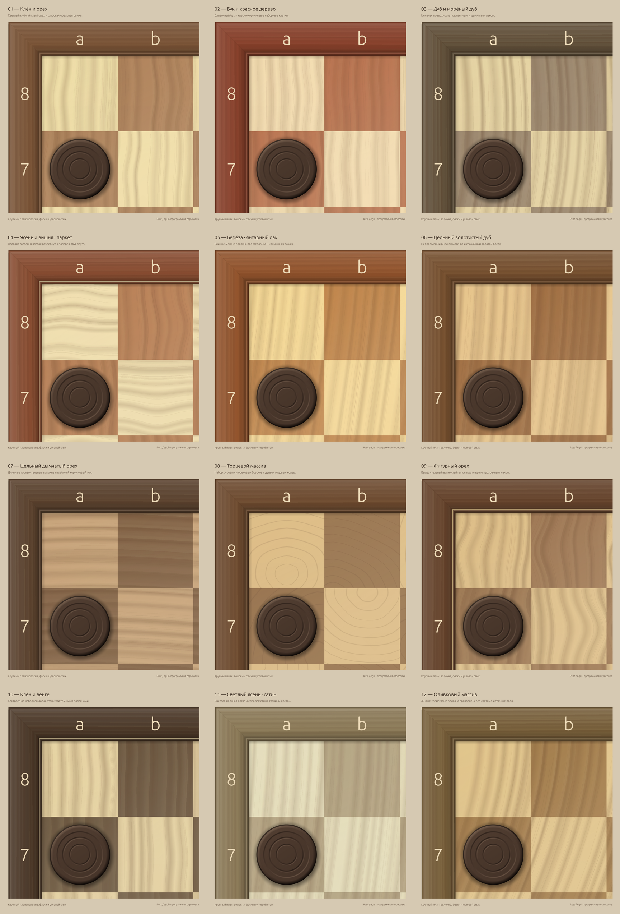

# Деревянные доски — нативная отрисовка на Rust

12 вариантов на основе `main` @ `c7b78c4`: более выраженные волокна, рельефная
рамка с фасками, стыками под 45° и тенью от внутреннего бортика. Первые пять
вариантов соответствуют направлениям из образца. В остальных сохранено
разнообразие цельной древесины, набора, торцевых срезов и фигурного шпона.

**Все изображения ниже — скриншоты нативного окна Rust / egui / OpenGL.**
Доски рисуются цветными треугольниками и линиями. Фотографий, растровых текстур,
SVG, генератора изображений и пользовательских шейдеров в отрисовке нет.
Шашки — тот же `PieceSprites` и `draw_piece`, что использует игра; их изображение
вычисляется текущим Rust-кодом приложения. PNG здесь нужны только для выбора.

[Крупные планы всех рамок и фактур](details.png) ·
[Все доски целиком](overview.png) ·
[Доски с шашками](overview-with-pieces.png)



| № | Материал | Конструкция | Полная доска | Крупный план |
| --- | --- | --- | --- | --- |
| 01 | Клён и орех | Наборные клетки | [Открыть](01.png) | [Открыть](01-detail.png) |
| 02 | Бук и красное дерево | Наборные клетки | [Открыть](02.png) | [Открыть](02-detail.png) |
| 03 | Дуб и морёный дуб | Единый массив под двумя оттенками лака | [Открыть](03.png) | [Открыть](03-detail.png) |
| 04 | Ясень и вишня | Паркет с попеременным направлением волокон | [Открыть](04.png) | [Открыть](04-detail.png) |
| 05 | Берёза под янтарным лаком | Единый рисунок под медовым и коньячным лаком | [Открыть](05.png) | [Открыть](05-detail.png) |
| 06 | Золотистый дуб | Цельная поверхность | [Открыть](06.png) | [Открыть](06-detail.png) |
| 07 | Дымчатый орех | Массив с горизонтальными волокнами | [Открыть](07.png) | [Открыть](07-detail.png) |
| 08 | Торцевой массив | Отдельные дубовые и ореховые бруски | [Открыть](08.png) | [Открыть](08-detail.png) |
| 09 | Фигурный орех | Волнистый шпон | [Открыть](09.png) | [Открыть](09-detail.png) |
| 10 | Клён и венге | Контрастный набор | [Открыть](10.png) | [Открыть](10-detail.png) |
| 11 | Светлый ясень | Цельная поверхность, сатин, тонкая сетка | [Открыть](11.png) | [Открыть](11-detail.png) |
| 12 | Оливковое дерево | Извилистые волокна цельного массива | [Открыть](12.png) | [Открыть](12-detail.png) |

## Нативный просмотр

Нужны обычные зависимости сборки rucheckers. Дополнительных Rust-крейтов нет.

```sh
cargo run --locked --example board_designs
cargo run --locked --example board_designs -- --variant 4 --pieces
cargo run --locked --example board_designs -- --variant 4 --detail
```

Управление: **← / →** — вариант, **пробел** — шашки, **Z** — крупный план.
При изменении размера окна рисунок перестраивается под новый размер доски.
Крупный план перерисовывает геометрию в большем размере, поэтому это не
увеличенная растровая картинка.

## Код для игры

[`src/gui/board_materials.rs`](../../src/gui/board_materials.rs) содержит все
12 материалов и `BoardArt::draw(&Painter, &BoardLayout, style, pixels_per_point)`.
[`examples/board_designs.rs`](../../examples/board_designs.rs) подключает этот
модуль напрямую, использует исходный `BoardLayout` и текущий рендерер шашек.

Для включения выбранных материалов в игру нужно хранить `BoardArt` рядом с
текущим кэшем шашек и вызывать его вместо отрисовки прежнего материала доски.
Материал выбирается индексом `MATERIALS`. Пользовательский выбор и сохранение
настройки остаются этапом после утверждения дизайнов.

Широкие полупрозрачные полосы создают основной рисунок древесины, тонкие линии
добавляют поры. У цельных вариантов одна система волокон пересекает всё поле;
у наборных клетки имеют собственный рисунок. У рамки четыре трапециевидные
деревянные планки с фасками. Лак — общий мягкий градиент на поверхности.
Тонкая сетка нужна только у светлого варианта 11.

Геометрия детерминирована и кэшируется до смены материала, размера, положения
или плотности пикселей. При обычной перерисовке пути не вычисляются заново.
Цвета полупрозрачных слоёв учитывают смешение в текущем `egui_glow`, чтобы
светлые волокна не пересвечивали тёмные клетки.

## Воспроизведение скриншотов

```sh
python3 tools/board-designs/capture.py
```

Скрипт запускает нативный пример, получает 36 кадров из framebuffer через
`ViewportCommand::Screenshot` и собирает PNG с помощью ImageMagick.
Нужны Python 3 и ImageMagick только для упаковки скриншотов, не для игры.
На Linux без дисплея можно использовать `xvfb-run -a` перед командой.

Отдельно можно получить кадры без Python и ImageMagick:

```sh
cargo run --locked --example board_designs -- --capture work/board-designs-native
cargo run --locked --example board_designs -- --variant 4 --capture-one work/board-designs-native
```

Получаются PPM: полная доска, доска с шашками и крупный план каждого материала.
Для повторной упаковки уже снятых кадров:

```sh
python3 tools/board-designs/capture.py --reuse
```

Проверки: сборка нативного примера и приложения, `cargo fmt --all -- --check`,
`cargo clippy --locked --example board_designs -- -D warnings`,
`cargo test --locked --example board_designs`. Тесты проверяют корректность
геометрии всех 12 материалов на трёх размерах, ограничение числа вершин,
отсутствие текстур доски и смешение прозрачных цветов без пересвета.
