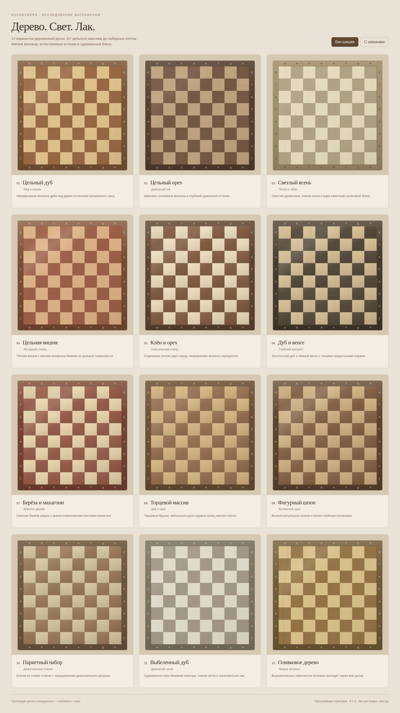

# 12 вариантов программной деревянной доски

Основа: `main`, коммит `c7b78c444bbdab447409829c2af1dd7e0c167c2a`.

Это воспроизводимые **программные SVG-превью для выбора дизайна**. Волокна,
торцевые кольца, стыки, рамка и мягкие блики лака рисуются кодом. Исходных
растровых текстур, фотографий, сгенерированных изображений и сетевых ресурсов
нет. PNG в этой папке — только скриншоты результата.

Пропорции соответствуют `src/ui/geometry.rs`: поле 8×8, рамка около 5% ширины,
координаты с четырёх сторон, тёмное поле `a1`. Фон взят из `src/gui/theme.rs`.
Эта стадия предназначена для выбора материала; подключение выбранных вариантов
к нативному рендереру `egui` и настройкам игры — следующий этап.

[Общий лист в полном размере](overview.png) ·
[Те же варианты с шашками](overview-with-pieces.png)



| № | Дизайн | Конструкция | Крупный скриншот |
| --- | --- | --- | --- |
| 01 | Цельный дуб | Непрерывные волокна, мёд и коньяк | [Открыть](01.png) |
| 02 | Цельный орех | Непрерывные горизонтальные волокна, дымчатый лак | [Открыть](02.png) |
| 03 | Светлый ясень | Светлый массив, тонкие границы клеток | [Открыть](03.png) |
| 04 | Цельная вишня | Тёплый массив, янтарный глянец | [Открыть](04.png) |
| 05 | Клён и орех | Наборные клетки двух пород | [Открыть](05.png) |
| 06 | Дуб и венге | Контрастные наборные клетки | [Открыть](06.png) |
| 07 | Берёза и махагони | Светлый и красно-коричневый набор | [Открыть](07.png) |
| 08 | Торцевой массив | Дуги годовых колец в отдельных брусках | [Открыть](08.png) |
| 09 | Фигурный шпон | Волнистый рисунок и глубокая полировка | [Открыть](09.png) |
| 10 | Паркетный набор | Диагональные планки внутри клеток | [Открыть](10.png) |
| 11 | Выбеленный дуб | Серо-бежевый массив, тонкие границы клеток | [Открыть](11.png) |
| 12 | Оливковое дерево | Выразительные непрерывные волокна | [Открыть](12.png) |

## Как посмотреть и изменить

Нужен Node.js 18 или новее. Для генерации не требуются пакеты npm.

```sh
node tools/board-designs/generate.mjs
```

Открыть `work/board-designs/index.html` в браузере. В галерее можно переключать
вид с шашками и без них, нажимать на карточки для просмотра отдельной доски.
Рядом сохраняются 12 отдельных SVG и параметры `designs.json`. Если браузер
ограничивает локальные файлы, можно запустить сервер:

```sh
python3 -m http.server 8765 --bind 127.0.0.1 --directory work/board-designs
```

Адрес галереи: `http://127.0.0.1:8765`.

Все параметры находятся в массиве `designs` в
[`generate.mjs`](../../tools/board-designs/generate.mjs): цвета светлых и тёмных
полей, рамки, направление и выраженность волокон, интенсивность лака и тип
сборки. Рисунок детерминирован: при одинаковых параметрах он не меняется.
Границы клеток включены только у вариантов 03 и 11; у остальных достаточно
цветового контраста.

Отрисовка использует прямоугольники, полилинии, градиенты и обрезку по границам.
Нет шейдеров, фильтров размытия или попиксельного синтеза. Для переноса в
`egui` можно использовать те же пути и полупрозрачные цветные mesh-градиенты,
кэшируя геометрию при смене стиля и размера доски. Скриншоты в игру не нужны.

## Скриншоты и проверка

[`capture.mjs`](../../tools/board-designs/capture.mjs) использует Playwright
только для проверки галереи и снятия скриншотов. При отсутствии Playwright его
можно установить отдельно от приложения:

```sh
npm install --prefix work/board-designs playwright
NODE_PATH="$PWD/work/board-designs/node_modules" node tools/board-designs/capture.mjs
```

Для установленного системного Chromium указать путь, например:

```sh
NODE_PATH="$PWD/work/board-designs/node_modules" CHROMIUM_PATH=/usr/bin/chromium node tools/board-designs/capture.mjs
```

Без `CHROMIUM_PATH` используется браузер Playwright; при необходимости установить
его командой `work/board-designs/node_modules/.bin/playwright install chromium`.

Проверено в Chromium: все 12 вариантов содержат 64 одинаковые квадратные клетки
с правильным чередованием, SVG-идентификаторы не конфликтуют, отсутствуют
растровые элементы и внешние запросы. Переключение шашек, переходы между
карточками и галереей и отображение при ширине 390 px работают. В обеих
палитрах шашек проверена читаемость на общем листе. Шашки в стенде нарисованы
векторно для сравнения и не заменяют текущие спрайты приложения.
